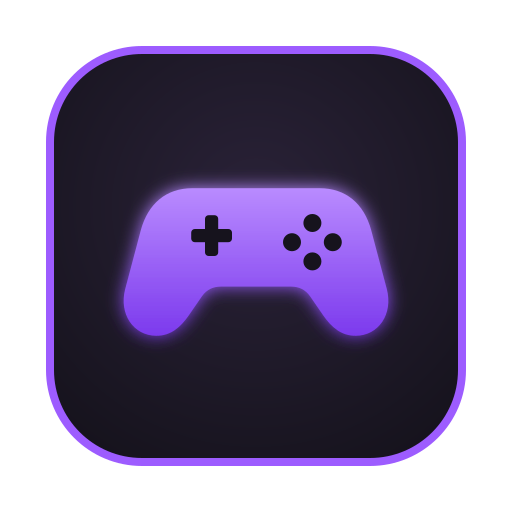
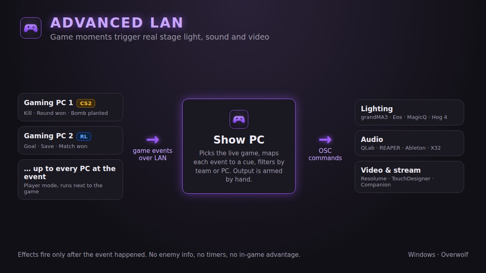
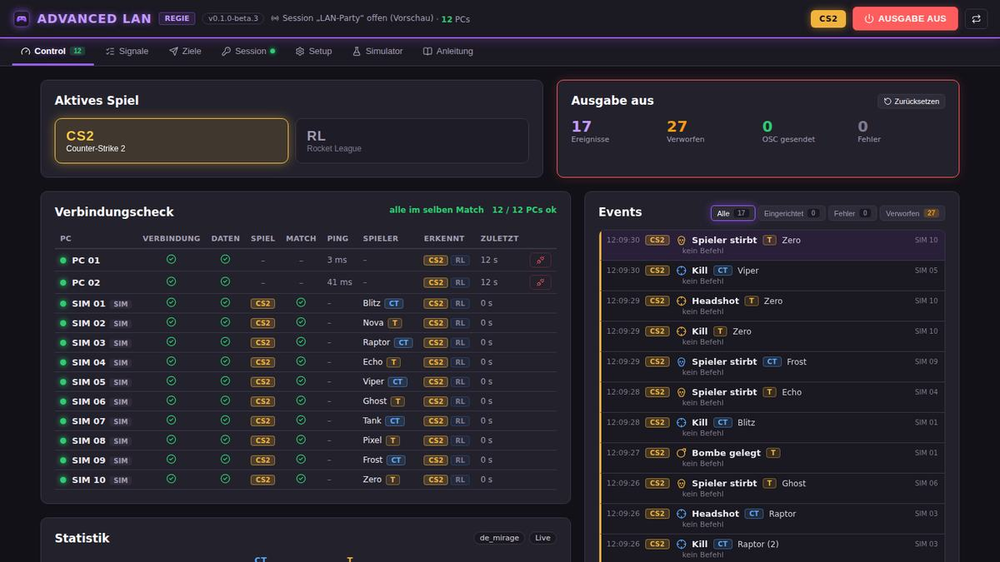
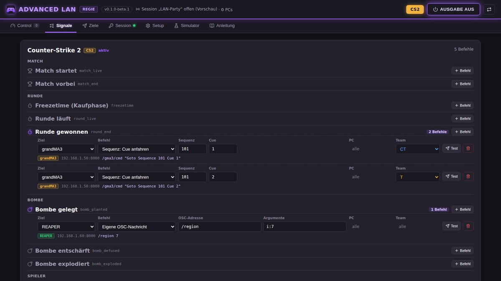
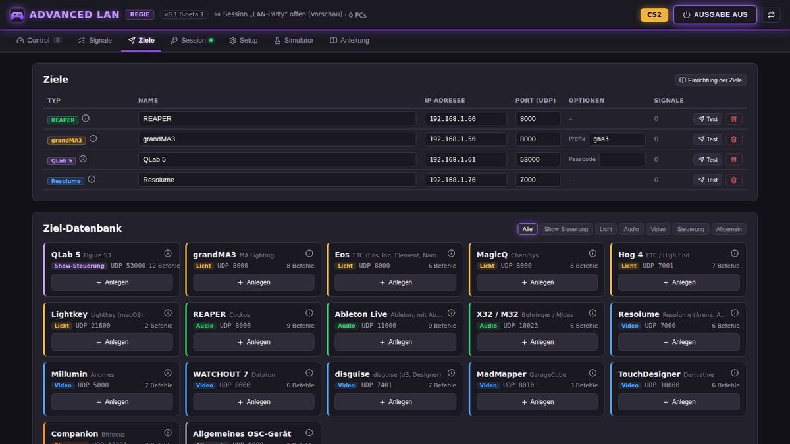
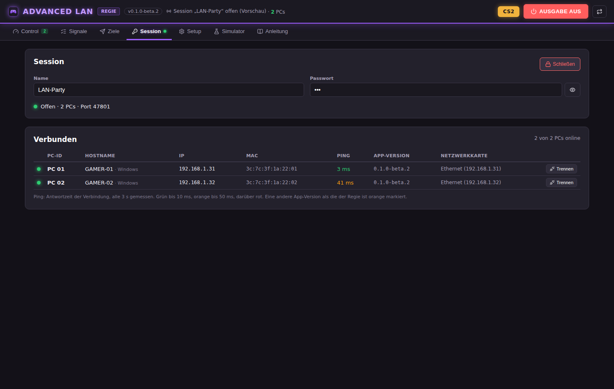
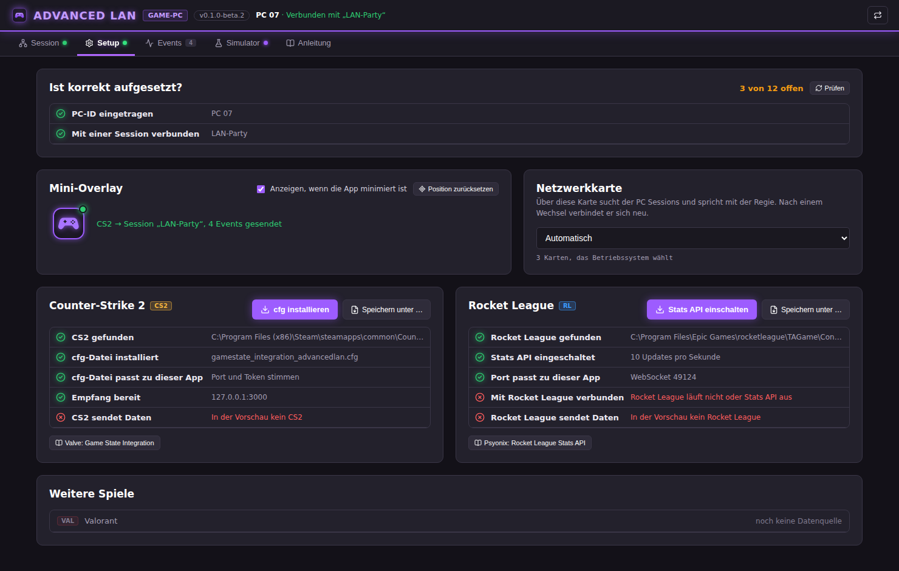
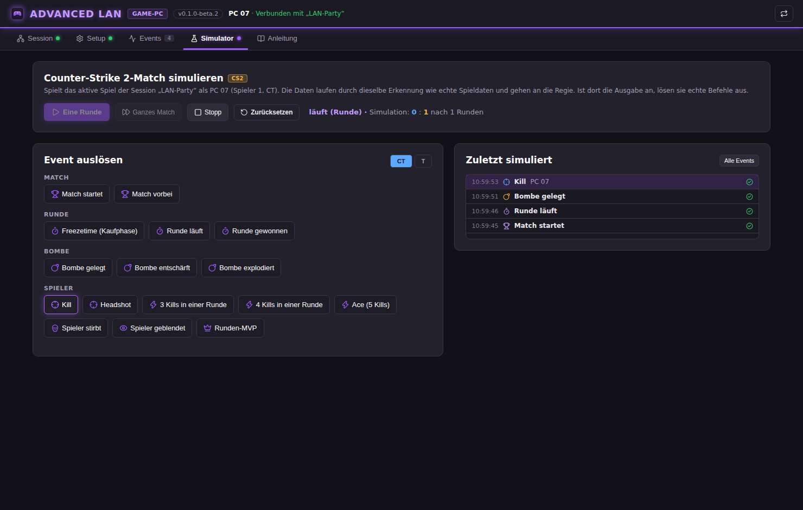
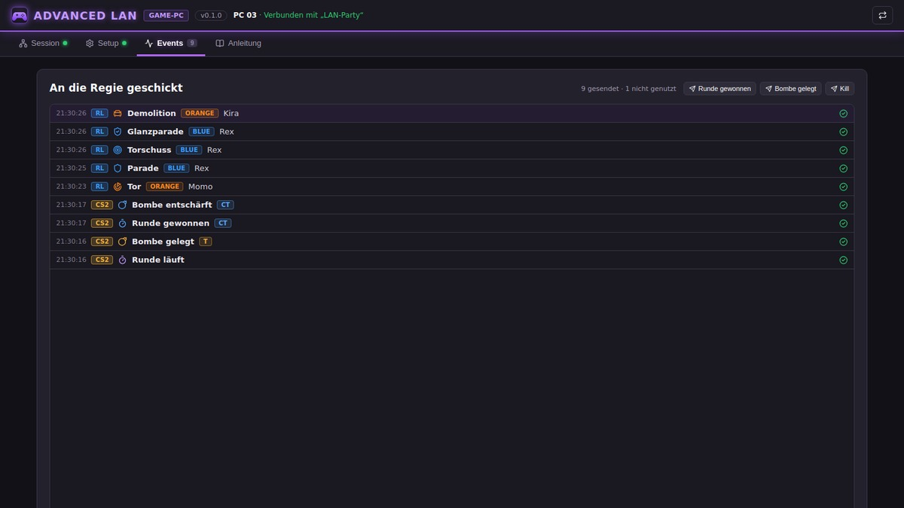
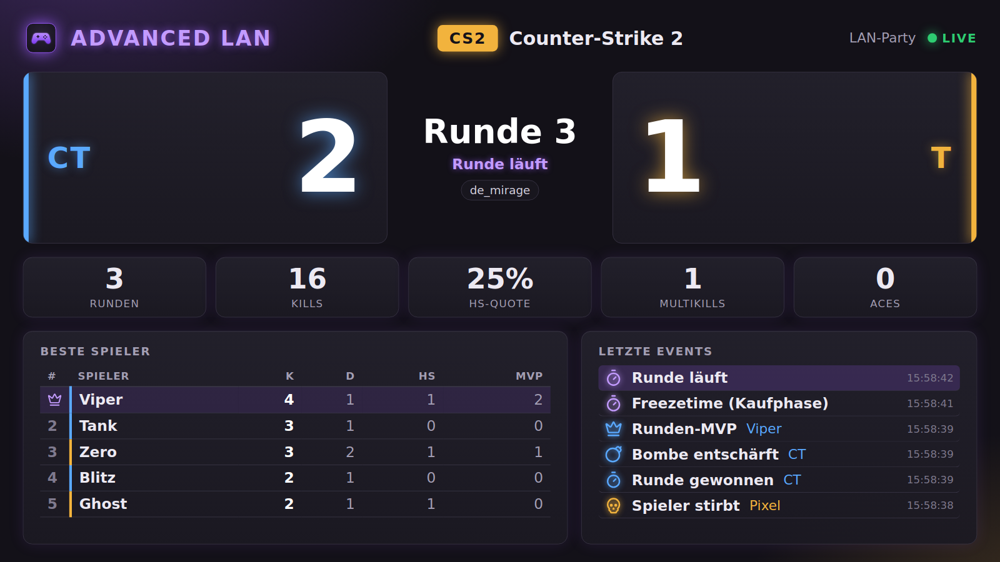

<p align="center">
  
</p>

<h1 align="center">Advanced LAN</h1>

<p align="center">Spielmomente lösen echtes Bühnenlicht, Ton und Video aus.<br>
<a href="https://github.com/Nomisimo/Advanced-Lan/releases">Download (Beta, macOS Intel)</a></p>

<p align="center"></p>

Eine App für die LAN-Party: Die Game-PCs melden Spielereignisse aus CS2, Rocket League und Dota 2 über ihre offiziellen Schnittstellen, Valorant und The Finals über eine Bilderkennung, die Regie sendet daraus OSC-Befehle an Lichtpulte, Audio- und Videosoftware (z. B. grandMA3, QLab, Reaper, Resolume). Design und Aufbau wie [Netzwerkplaner](https://github.com/Nomisimo/Netzwerkplaner) und Stromplaner, Akzentfarbe Lila.

Gebaut mit **Electron** und electron-builder, React 18 und esbuild. Ohne Overwolf. Die Oberfläche wird zu einer einzelnen Datei `dist-app/index.html` gebündelt.

## Drei Modi, eine App

| Modus | Läuft auf | Tabs |
|---|---|---|
| **Game-PC** | jedem PC, auf dem gespielt wird | Session (PC-ID, Sessions im Netz, beitreten, Netzwerkkarte), Setup („Ist korrekt aufgesetzt?“-Check, CS2, Dota 2 und Rocket League einrichten, Mini-Overlay), Bilderkennung (Editor für Valorant und The Finals), Events, Simulator (nur mit Session), Anleitung |
| **Regie** | dem Regie-PC (ohne Spiel) | Control (aktives Spiel, Ausgabe, Verbindungscheck, Statistik, Events), Session (mit Übersicht: PC-ID, Hostname, IP, MAC, Ping, App-Version, Empfangskarte), Ziele (mit OSC-Karte), Plan (PC-Plätze, Spalte je Ziel, Game-PC-Vorlage), Signale (Allgemein + Abweichungen je Spiel), Stats-Screen (Editor, Pop-out, NDI), Setup (genutzte Spiele, Check), Simulator, Anleitung |
| **Standalone** | einem einzelnen PC: Regie und Spiel zusammen | wie die Regie, dazu Spiele (Setup der Spiele auf diesem PC wie beim Game-PC). Die Spiele melden direkt an die Regie, eine Session braucht es nur für zusätzliche Game-PCs |

Der Modus wird beim ersten Start gewählt (Standalone: Textknopf unten in der Mitte) und lässt sich oben rechts wechseln. Alle Erklärungen stehen im Tab „Anleitung“.

- Die Regie öffnet eine **Session mit Name und Passwort**. Game-PCs sehen alle Sessions im Netz automatisch per mDNS (Multicast, Dienst `_advancedlan._tcp`), auch mehrere Regien. Keine IP- oder Port-Eingabe.
- Verbindung per WebSocket (Port 47801, falls belegt ein freier, per mDNS angekündigt). Passwort per Challenge-Response mit HMAC-SHA256.
- Die PC-ID lässt sich nur ändern, solange der PC in keiner Session ist.
- Game-PCs melden immer alle Spiele, die die App kennt. Nur die Regie entscheidet: Im Tab „Setup“ werden die genutzten Spiele gewählt, im Tab „Control“ (und nur dort) das aktive Spiel. Events anderer Spiele werden verworfen.
- Mehrere PCs melden dieselbe Runde oder Bombe: die Regie wertet jedes Event nur einmal aus.
- Die Ausgabe ist nach jedem Start **aus** (roter Knopf). Erst „AUSGABE AN“ (grün, pulsierend) schickt OSC.
- Die Zähler im Control-Tab entsprechen den Filtern im Event-Log und lassen sich zurücksetzen. Der Verbindungscheck zeigt, ob alle PCs im selben Match sind (CS2: Map und Spielstand, alle anderen: Match-ID).

- **Mini-Overlay (Game-PC):** Ist die App minimiert, zeigt ein kleines App-Icon mit Statuspunkt über allen Fenstern, ob alles läuft (grün: Session und Spieldaten ok, orange: verbindet oder keine Spieldaten, rot: keine Session oder Fehler). Verschiebbar, Klick öffnet die App, abschaltbar im Tab „Setup“ unter „Einstellungen“. Über exklusivem Vollbild zeichnet Windows keine Fenster; die App erkennt das (`SHQueryUserNotificationState` über einen PowerShell-Hintergrundprozess, `src/main/vollbild.js`), das Namens-Popup wartet dann, bis das Spiel das Vollbild verlässt, und die Regie sieht „Name offen“ und kann den Namen im Tab „Session“ eintragen. Im Spiel randloses Vollbild einstellen (Valorant „Vollbild im Fenster“, CS2 „Vollbild (Fenster)“, Rocket League „Randlos“).
- **Simulator auf dem Game-PC:** spielt mit verbundener Session das aktive Spiel der Regie, als liefe es auf diesem PC, und schickt die Events wirklich an die Regie.
- **Netzwerkkarten:** Die Regie wählt im Tab Session, über welche Karte sie Game-PCs empfängt, und im Tab Ziele, über welche sie OSC sendet, jedes Ziel kann eine eigene Karte haben; der Game-PC wählt seine Karte für die Session. Die App bindet Empfang bzw. Absender an die IP der Karte (eindeutig, wenn jede Karte in einem eigenen Subnetz liegt). Netzwerk-Anforderungen (IGMP, EEE, QoS …) stehen in der Anleitung.
- **Updates wie im Netzwerkplaner:** Die App prüft beim Start die GitHub-Releases und zeigt eine neuere Version als grünen Knopf neben der Versionsnummer. Mac: Klick lädt das DMG in den Download-Ordner und öffnet es, dann die App nach „Programme“ ziehen (unsigniert, deshalb kein Austausch im Hintergrund). Windows: `electron-updater` lädt und installiert selbst, sobald es Windows-Releases gibt. Klick auf die Versionsnummer öffnet „Was ist neu?“ (`src/core/version.js`, dort bei jeder Version die Änderungen eintragen).
- **Game-Stats-Screen (Regie, Standalone):** Spielstand, Runde oder Spielzeit, Zahlen des Matches, beste Spieler und letzte Events des aktiven Spiels, gestaltet für 1920×1080. Einschalten in Regie → Stats-Screen. Ausgabe als **Pop-out-Fenster** (Knopf „Stats“ in der Kopfzeile, Doppelklick = Vollbild) und/oder als **NDI-Quelle** mit eigenem Namen (30 fps, für OBS, vMix, NDI Studio Monitor). NDI rendert die Seite in einem unsichtbaren Offscreen-Fenster und schickt jedes Bild über [`@stagetimerio/grandiose`](https://github.com/stagetimerio/grandiose) (NDI SDK 6, Apache-2.0). Das Paket ist optional: Es lädt beim Installieren das NDI SDK von ndi.tv und baut sich mit node-gyp. Fehlt es, zeigt das Setup „NDI nicht verfügbar“, alles andere läuft. NDI® ist eine eingetragene Marke von Vizrt NDI AB.
- **Screen-Editor (Regie → Stats-Screen):** Layout des Game-Stats-Screens per Drag and Drop: Anzeigen verschieben, Größe an den Griffen ändern, ausblenden, eigene Texte mit Platzhaltern (`{spiel}`, `{session}`, `{team1}`, `{score1}` …), Raster und Einrasten an Kanten und Mitten, Rückgängig, Hintergrund Verlauf, Schwarz oder Grün. Gespeichert in `regie.stats.layout`, Pop-out-Fenster und NDI übernehmen es sofort (`src/core/stats-layout.js`, `src/renderer/regie/ScreenTab.jsx`).
- **Planer (Regie → Plan):** Plätze der Game-PCs vorab anlegen, auch ohne verbundenen Rechner. Je Ziel eine Spalte mit Regel für alle Plätze (`{100+nr}` → 101, 102 …) und eigenen Zellen; in den Signalen setzt `{plan}` den Wert des auslösenden PCs ein, dazu `{nr}`, `{nr2}` und Rechnungen. Steht beim Platz der Rechner (Hostname oder MAC), vergibt die Regie beim Beitreten die PC-ID. Die Game-PC-Vorlage (Spiele, Bilderkennung, Overlay, Namens-Popup) verteilt die Regie über die Session, das Einrichtungspaket legt je Platz eine Game-PC-Show mit PC-ID ab (`src/core/plan.js`, `src/renderer/regie/PlanTab.jsx`).
- **Allgemeine Signale:** Kill, Tod, Sieg & Co. einmal einrichten, gilt in jedem Spiel; je Spiel ergänzen oder ersetzen (`src/core/aktionen.js`).
- **Startanimation** wie im Netzwerkplaner: Controller, dessen Knöpfe nacheinander gedrückt werden.
- CS2, Rocket League, Valorant und The Finals gibt es als Game-PC nur unter Windows, Dota 2 auch auf dem Mac. Auf dem Mac läuft vor allem die Regie; der Game-PC-Modus meldet dort, welche Spiele fehlen.

## Spiele

| Spiel | Datenquelle | Teams | Simulator |
|---|---|---|---|
| Counter-Strike 2 | Valve Game State Integration | CT, T | 10 PCs, Runde |
| Rocket League | Psyonix Stats API | BLUE, ORANGE | 6 PCs, bis zum Tor |
| Dota 2 | Valve Game State Integration | RADIANT, DIRE | 10 PCs, 5 Minuten |
| Valorant | Bilderkennung | TEAM A, TEAM B (stellt jeder PC ein) | 10 PCs, Runde |
| The Finals | Bilderkennung | TEAM A bis TEAM D | – |

Overwolf ist raus: Die App läuft auf normalem Electron, nutzt keine Overwolf-Spielereignisse (GEP) und wird nur über GitHub verteilt. Optional kann ein Valorant-PC zusätzlich die Overwolf-App „Automation Overdrive“ nutzen (eigene Installation, siehe Setup). Der Knopf „Automation Overdrive öffnen“ im Setup startet sie über Overwolf oder führt zum Store.

## Screenshots

| Regie: Control | Regie: Signale |
|---|---|
|  |  |
| **Regie: Ziele** | **Regie: Session-Übersicht** |
|  |  |
| **Game-PC: Setup** | **Game-PC: Simulator** |
|  |  |
| **Game-PC: Events** | **Game-Stats-Screen** |
|  |  |

## CS2

CS2 liefert seine Daten über Valves offizielle [Game State Integration](https://developer.valvesoftware.com/wiki/Counter-Strike:_Global_Offensive_Game_State_Integration): Eine cfg-Datei im CS2-Ordner (`…\game\csgo\cfg\gamestate_integration_advancedlan.cfg`) lässt das Spiel seinen Zustand per HTTP an die App auf demselben PC schicken (`127.0.0.1:3000`). Der Game-PC installiert die Datei per Knopfdruck im Tab „Setup“ und prüft dort, ob alles stimmt. Dafür braucht es keine Freigabe.

Erkannte Ereignisse: Match startet/vorbei, Freezetime, Runde läuft, Runde gewonnen (mit Team), Bombe gelegt/entschärft/explodiert, Kill, Headshot, 3 und 4 Kills, Ace, Tod, geblendet, Runden-MVP.

## Rocket League

Rocket League liefert seine Daten über die offizielle [Stats API](https://www.rocketleague.com/developer/stats-api) von Psyonix: `TAGame\Config\TAStatsAPI.ini` im Spielordner (Epic Games oder Steam) schaltet sie ein (`PacketSendRate=10`), dann schickt das Spiel `{ Event, Data }`-Nachrichten per WebSocket an die App auf demselben PC (`127.0.0.1:49124`). Der Game-PC schreibt die ini per Knopfdruck im Tab „Setup“.

Erkannte Ereignisse: Match startet/vorbei, Anstoß, Verlängerung, Siegerehrung, Tor, Vorlage, Hattrick, Tor-Wiederholung, Torschuss, Parade, Glanzparade, Demolition, Latte, MVP. Teams heißen `BLUE` und `ORANGE`. Die Stats API meldet alle Spieler des Matches; deshalb gibt es bei Rocket League keinen PC-Filter, nur den Team-Filter.

## Dota 2

Dota 2 liefert seine Daten wie CS2 über Valves [Game State Integration](https://developer.valvesoftware.com/wiki/Dota_2_Workshop_Tools/Scripting/Game_State_Integration): `gamestate_integration_advancedlan.cfg` in `…\dota 2 beta\game\dota\cfg\gamestate_integration\` schickt den Zustand an denselben Empfang wie CS2 (`127.0.0.1:3000`, erkannt an `provider.appid` 570). Zusätzlich braucht Dota die Startoption `-gamestateintegration`; der Setup-Check liest sie aus Steams `localconfig.vdf`. Ein spielender PC meldet seinen eigenen Helden und die Gebäude seines Teams.

Erkannte Ereignisse: Heldenwahl, Vorbereitung, Horn, Ancient zerstört (mit Sieger), Tag, Nacht, Roshan getötet, Aegis, Turm und Kaserne zerstört (Team = wer zerstört hat), Kill, Double Kill, Triple Kill, Ultra Kill, Rampage, Assist, Tod.

## Valorant und The Finals (Bilderkennung)

Riot und Embark geben keine Live-Daten frei. Deshalb schaut die App auf dem Game-PC selbst auf den Bildschirm (Tab „Bilderkennung“):

1. **Aufnehmen:** Im Editor eine Runde spielen und aufzeichnen (oder ein eigenes Video laden). Die Aufnahme bleibt nur im Arbeitsspeicher und ist weg, sobald man sie löscht oder die App schließt.
2. **Aktionen anlegen:** Zum passenden Moment spulen, einen Bereich aufziehen (z. B. das Banner „Runde gewonnen“) und ihn als Aktion mit einem Event übernehmen. Eine Aktion kann bis zu 6 Bereiche als Auslöser haben (ein Bereich reicht oder alle gleichzeitig), je Bereich bis zu 12 Frames, eine Schwelle für die Ähnlichkeit, eine Pause und optional ein Wort, das dort stehen muss (Texterkennung mit Tesseract.js, Englisch und Deutsch, lokal ohne Internet). Mehrere Wörter mit `|` trennen.
3. **Testen:** „Erkennung testen“ läuft über die Aufnahme und zeigt, wann welche Aktion erkannt würde.
4. **Teilen:** Export schreibt eine `.json`-Datei mit Bereichen und Frames (ohne Team), Import auf den anderen Game-PCs übernimmt sie. Hat der andere Bildschirm ein anderes Seitenverhältnis, rechnet die App die Bereiche nach ihrem Anker (links/mitte/rechts, oben/mitte/unten) um.

Die App merkt selbst, wenn ein Spiel geöffnet wird (Fenstertitel `VALORANT` bzw. `THE FINALS`), und nimmt sein Fenster als Bildquelle. Sind mehrere Spiele offen, läuft für jedes eine eigene Erkennung. Je Spiel lässt sich als Bildquelle auch jedes andere offene Fenster oder Programm wählen (auch über einen Teil des Titels, z. B. „OBS“) oder der Bildschirm. Erkannt wird mit 2 bis 10 Bildern pro Sekunde. Verglichen werden verkleinerte Graustufen-Signaturen (`src/core/bild-erkennung.js`), die Ereignisse daraus macht `src/core/bild-spiele.js`, die Aufnahme läuft in einem unsichtbaren Fenster (`src/main/bild.js`, `src/renderer/erkennung.js`). Exklusives Vollbild lässt sich oft nicht aufnehmen (schwarzes Bild); die App warnt dann und empfiehlt „Randloses Fenster“.

Valorant: Riot erlaubt keine Hinweise auf den Spike-Timer. Die App meldet deshalb nur „Spike gelegt“ und „Spike entschärft“, ohne Countdown.

## OSC: Ziele und Signale

Die Regie sendet, **was passieren soll**.

- **Ziele**: Geräte werden aus der Ziel-Datenbank angelegt (`src/core/ziel-typen.js`), jedes mit IP, Port und ggf. Optionen (z. B. MA3-Prefix). Enthalten: QLab 5, grandMA3, ETC Eos, ChamSys MagicQ, Hog 4, Lightkey, REAPER, Ableton Live (AbletonOSC), Behringer X32/M32, Resolume, Millumin, WATCHOUT 7, disguise, MadMapper, TouchDesigner, Bitfocus Companion und ein allgemeines OSC-Gerät. grandMA2, Avolites Titan, vMix, OBS und Allen & Heath haben keinen OSC-Eingang und laufen über Companion. Die Recherche dazu steht in [`docs/osc-ziele.md`](docs/osc-ziele.md).
- **Signale**: je Spiel und Event beliebig viele Befehle `Ziel → Befehl → Werte`, optional gefiltert nach PC-ID (Spieler-Events) und Team. Beispiel Rocket League Tor: Reaper „Audio ab Marker 4“ (`/marker/4`, `/play`) und grandMA3 „Sequenz: Cue anfahren“ (`/gma3/cmd "Goto Sequence 101 Cue 3"`).
- Werte dürfen Platzhalter enthalten: `{spieler}`, `{team}`, `{pc}`, `{runde}`, `{spiel}`, `{event}`.
- Jedes Ziel kennt „Eigene OSC-Nachricht“ mit freier Adresse und Argumenten (`s:{spieler} i:3 f:0.5 T`).
- Ein Event ohne Befehl erscheint nur im Log. „Test“ in „Signale“ sendet einen Befehl sofort, „Test“ in „Ziele“ eine harmlose Testnachricht.

Einstellungen aus Version 0.1.0-beta.1 (neutrale Signale) werden übernommen: Ziele werden „Allgemeines OSC-Gerät“, die alten An/Aus-Schalter entfallen.

## Entwickeln

```bash
npm install
npm test           # Erkennung, Regie, Netzwerk (WebSocket, UDP, OSC)
npm start          # baut die Oberfläche und startet Electron
npm run dist:win   # Windows-Installer mit electron-builder
npm run dist:mac   # macOS Intel (dmg), nur auf einem Mac
```

**Beta-Releases:** Ein Tag `v*` (z. B. `v0.1.0-beta.1`) oder Actions → Release startet `.github/workflows/release.yml`: Builds für Windows (x64) und macOS Intel auf GitHub-Runnern, Ergebnis als Release, Tags mit Bindestrich (`-beta.n`) als Vorabversion. Wie im Netzwerkplaner prüft der Workflow, dass Tag und `version` in `package.json` passen, und baut den Release-Text aus dem „Was ist neu?“-Eintrag in `src/core/version.js` plus `.github/release-hinweise.md` (Download und Installation). Ablauf: Version in `package.json` erhöhen, Änderungen in `src/core/version.js` eintragen, committen, dann `git tag v0.1.0-beta.7 && git push origin v0.1.0-beta.7`. Beide sind noch unsigniert: Windows warnt mit SmartScreen (Weitere Informationen → Trotzdem ausführen), auf dem Mac beim ersten Start Rechtsklick → Öffnen. Apple Silicon folgt.

`dist-app/index.html` lässt sich auch direkt im Browser öffnen: Dann läuft eine Vorschau ohne Netzwerk, mit derselben Regie-Logik und dem Simulator.

| Ordner | Inhalt |
|---|---|
| `src/core` | Logik ohne Electron: Ereigniserkennung je Spiel (CS2, Rocket League, Dota 2, Bilderkennung für Valorant und The Finals), Regie, Ziel-Datenbank, Signale, Statistik, Simulator, Protokoll |
| `src/main` | Hauptprozess: Session-Server, Game-PC-Verbindung, GSI-Empfang, Bilderkennung mit Texterkennung, OSC, Game-Stats-Screen (Fenster, NDI) |
| `src/renderer` | Oberfläche (React): Modus-Wahl, `regie/`, `gamepc/`, `StatsScreen.jsx` (`index.html#stats`) |

## Lizenz

[MIT](LICENSE). Nutzungsbedingungen: [docs/TERMS.md](docs/TERMS.md), Datenschutz: [docs/PRIVACY.md](docs/PRIVACY.md).
